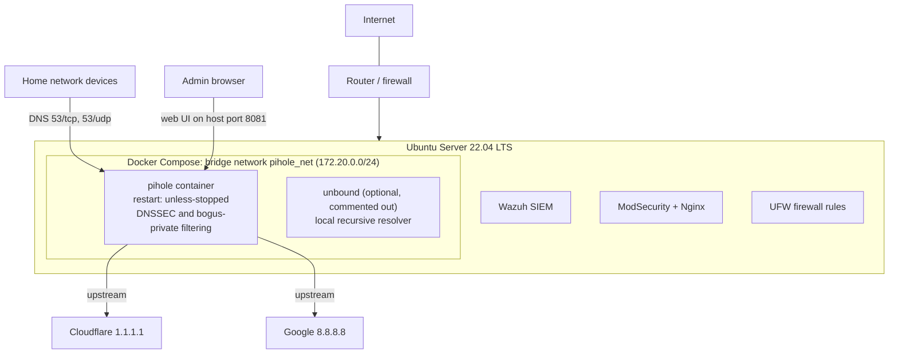
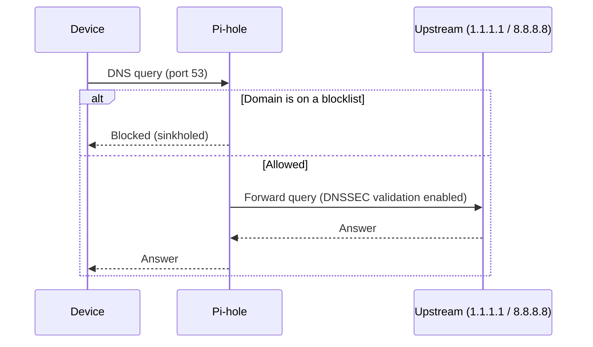

# Pi-hole DNS Infrastructure Architecture

This is a **legacy portfolio project**, preserved as a snapshot of how DNS filtering was first deployed. This document describes that design as it is defined in `docker-compose.yml` and the [phase documentation](docs/). Current DNS policy work lives in [NET-WATCH](https://github.com/scott-renny/netwatch).

## Deployment context

Pi-hole was added to an Ubuntu Server 22.04 host that was already running Wazuh SIEM, ModSecurity and Nginx. The aim was to integrate DNS filtering into a realistic multi-service environment instead of a clean install. Two port conflicts followed from that, both recorded in [Phase 1 troubleshooting](docs/PHASE1-troubleshooting.md).

## DNS query path

## Configuration summary

| Setting | Value | Why |
|---|---|---|
| Image | `pihole/pihole:latest` | Mature DNS filtering with DNSSEC support |
| Restart policy | `unless-stopped` | Recovers from crashes and host reboots |
| DNS ports | 53/tcp and 53/udp published | Serves the network |
| Web UI | Host port `8081` (configurable) mapped to container port 80 | Port 80 was already in use on the host |
| Upstream resolvers | 1.1.1.1 and 8.8.8.8 | Resilient upstream resolution across two providers |
| DNSSEC | Enabled, plus `volumes/pihole/etc-dnsmasq.d/99-dnssec.conf` | In Pi-hole v6 the environment variable alone was not enough ([Problem 6](docs/PHASE1-troubleshooting.md)) |
| Hardening | `DNS_BOGUS_PRIV`, `DNS_FQDN_REQUIRED` enabled | Keeps private and unqualified lookups from leaking upstream |
| Container DNS | Explicit `dns:` entries | Lets the container resolve during its own startup and health check |
| Capabilities | `NET_ADMIN` | Required by the image |
| Volumes | `./volumes/pihole/etc-pihole`, `./volumes/pihole/etc-dnsmasq.d` | Persist configuration and blocklists across container rebuilds |
| Secrets | `.env` (not committed; `env.example` provided) | Admin password never lives in the compose file |

## Rollout phases

| Phase | Approach | Result |
|---|---|---|
| 1 | Change DNS manually on two personal devices | Validated Pi-hole end to end |
| 2 | Set the router's DHCP DNS: primary is Pi-hole, secondary is 1.1.1.1 as a fallback only | Every device is covered with no per-device setup. Reversible in one step and leaves the router's own DHCP server running ([Phase 2](docs/PHASE2-network-rollout)) |

Pi-hole must keep a static IP or a DHCP reservation. If its address changes after a reboot, every device loses DNS at once.

## Limitations and lessons

These match the project's own retrospective:

- A single Pi-hole instance is a single point of failure for DNS. While the fallback resolver is in use, queries are not filtered.
- There are no automatic backups of the Pi-hole configuration.
- There is no DNS-over-HTTPS/TLS and no health monitoring or dashboard.
- Configuration is not managed with an automation tool.

Further improvements listed there: redundant Pi-hole instances, DoH/DoT, health checks and alerting, Grafana dashboards and configuration management.

## Related documents

- [README](README.md)
- [Phase 1 troubleshooting](docs/PHASE1-troubleshooting.md)
- [Phase 2 network rollout](docs/PHASE2-network-rollout)
- [`docker-compose.yml`](docker-compose.yml) and [`setup.sh`](setup.sh)
